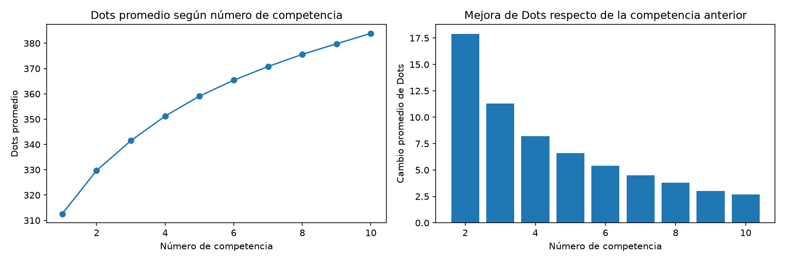
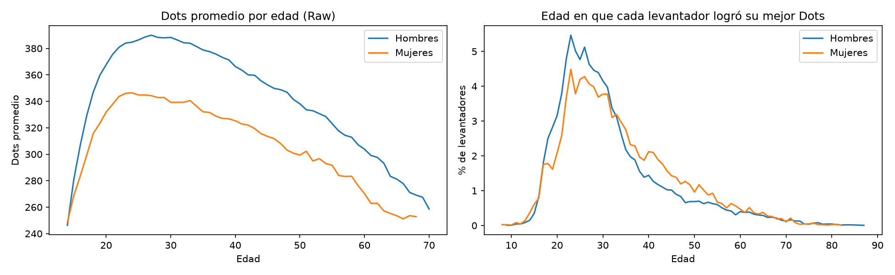
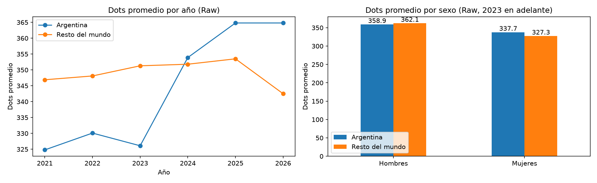

# Análisis de powerlifting con Python y SQL

Análisis exploratorio de más de 2,5 millones de resultados de competencias de
powerlifting para entender cómo se distribuye la fuerza según sexo, edad, peso
corporal y país, y cómo se compara Argentina con el resto del mundo.

## Preguntas que busca responder
- ¿A qué edad se alcanza el pico de fuerza? 
- ¿Cómo progresa un levantador entre su primera y sus siguientes competencias?
- ¿Cómo se compara el rendimiento de Argentina con el resto del mundo? 
- ¿Qué tanto mejoran en promedio los levantadores más jóvenes? 
- ¿Cuánta diferencia hay entre competir con y sin equipamiento? *(pendiente)*

## Datos
Proyecto OpenPowerlifting (openpowerlifting.org), de dominio público (CC0).
Cada fila es un levantador en una competencia. Los datos no se incluyen en
este repo por su tamaño; ver "Cómo reproducirlo".

## Herramientas
Python (pandas, matplotlib, seaborn), SQLite, Jupyter, Git/GitHub.

## Estructura del repo
- `src/`: scripts de limpieza y carga a SQLite
- `sql/`: consultas con comentarios
- `notebooks/`: exploración y análisis
- `data/`: datos (no versionados)

## Cómo reproducirlo
1. Clonar el repo y crear un entorno virtual con Python 3.13.
2. Instalar dependencias: `pip install -r requirements.txt`
3. Descargar el CSV de openpowerlifting.org y guardarlo como `data/raw/openpowerlifting.csv`
4. Ejecutar `python src/limpieza.py`
5. Ejecutar `python src/cargar_sqlite.py`

## Decisiones de limpieza
Se partió de 4.059.940 filas y quedaron 2.591.805.
- Solo competencias completas (sentadilla, banca y peso muerto): el total de
  una competencia de solo banca no es comparable con el de una completa.
- Se descartaron filas sin total, peso corporal o Dots (232.436), típicamente
  levantadores descalificados o con datos incompletos.
- Se eliminaron 108.073 duplicados exactos, que parecen ser la misma actuación
  cargada dos veces en la misma competencia.
- No se borraron las filas sin edad (36% del dataset original): los análisis
  por edad usan solo las filas que la tienen.

## Hallazgos
### ¿Cómo progresa un levantador a lo largo de sus competencias?
*Consultas: `sql/02_funciones_ventana.sql`*

- El Dots promedio sube de 312,6 en la primera competencia a 383,9 en la décima.
- La mejora es mayor al principio (+17,9 entre la primera y la segunda) y se
  achica a +2,7 hacia la décima.
- Hipótesis descartada: no se quedan los que arrancaron más fuertes. El Dots de
  la primera competencia es casi igual (310 a 313) sin importar cuántas
  competencias hagan después.
- Salvedad: no se controló equipamiento ni edad.

- Los levantadores que compiten más veces no arrancan más fuertes: el Dots de
  la primera competencia es prácticamente el mismo (310 a 313) sin importar
  cuántas competencias hagan después.
- La mejora es mayor al principio (+17,9 Dots entre la primera y la segunda
  competencia) y se va achicando (+2,7 hacia la décima).
- El 45% de los levantadores compitió una sola vez.

### ¿A qué edad se alcanza el pico de fuerza?
*Consultas: `sql/03_edad.sql`*

- El Dots promedio llega a su máximo a los 27 años en hombres (390,0) y a los
  24 en mujeres (346,5).
- A los 40 años el promedio está un 6% por debajo del pico, a los 50 un 13% y
  a los 60 un 22%, con valores casi iguales en ambos sexos.
- Después de los 30 la baja es gradual y de forma parecida en ambos sexos.
- Los resultados se calculan solo con equipamiento Raw y edades exactas.
- Salvedades: cada edad promedia a personas distintas, y quienes compiten a
  edades altas son un grupo seleccionado. La edad de la mejor marca depende
  también de cuándo se compite, y no solo de cuándo se está más fuerte.

### ¿Qué tanto mejoran los levantadores según su edad al debutar?
*Consultas: `sql/03_edad.sql`*

Mejora de Dots entre la 1ª y la 5ª competencia (solo equipamiento Raw):

| Edad al debutar | Levantadores | Dots 1ª | Dots 5ª | Mejora |
|---|---|---|---|---|
| Menos de 20 | 14.808 | 312,4 | 373,7 | +61,3 |
| 20 a 29 | 21.804 | 353,8 | 398,5 | +44,7 |
| 30 a 39 | 7.628 | 340,8 | 374,2 | +33,4 |
| 40 a 49 | 4.148 | 314,6 | 340,3 | +25,7 |
| 50 o más | 3.264 | 274,7 | 293,0 | +18,4 |

- Cuanto más joven se debuta, mayor es la mejora.
- Quienes debutan entre 20 y 29 años llegan a la quinta competencia con el
  mejor nivel (398,5), aunque mejoran menos que los menores de 20.
- Salvedades: solo se incluyen quienes llegaron a 5 competencias Raw con edad
  informada, y no se controla el tiempo transcurrido entre competencias.

### ¿Cómo se compara Argentina con el resto del mundo?
*Consultas: `sql/04_argentina.sql`*

Comparando solo equipamiento Raw y el mismo período (2023 en adelante):

| | Argentina | Resto del mundo | Diferencia |
|---|---|---|---|
| Hombres | 358,9 | 362,1 | -3,2 |
| Mujeres | 337,7 | 327,3 | +10,4 |

- Argentina está en línea con el resto del mundo: apenas por debajo en
  hombres y algo por encima en mujeres.
- Mi hipótesis inicial era que Argentina estaba por encima del mundo. Al
  controlar por equipamiento, sexo y período, la diferencia casi desaparece.
- El promedio argentino sube con los años, pero parte de esa suba se debe a que
  cambian las federaciones que aportan datos (por ejemplo, desde 2024 aparecen
  FESUPO e IPL, con promedios más altos).
- Salvedades: "Argentina" se define por el país de la competencia; hay unas
  5.600 filas argentinas contra unas 471.000 del resto; cada fila es una
  competencia y no una persona; no se hizo ninguna prueba estadística.

## Limitaciones
- "Argentina" se define por el país de la competencia, no por la nacionalidad
  del levantador.
- Cada fila es una competencia, no una persona: quienes compiten más veces
  pesan más en los promedios.
- La edad aumenta el promedio en levantadores más jovenes, al mejorar más rápido.

## Autor
Ramirez Sergio Ezequiel - https://github.com/xdark-whisper