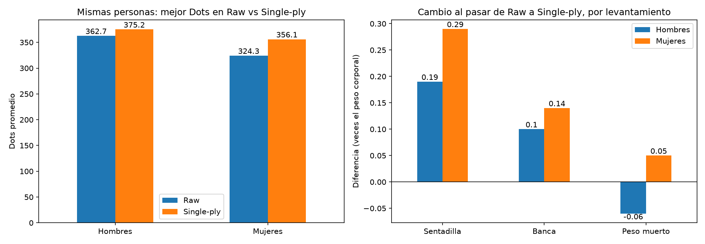

# Análisis de powerlifting con Python y SQL

> **Resumen:** analicé 2,6 millones de resultados de competencias de powerlifting
> (OpenPowerlifting) con Python y SQL (CTEs y funciones de ventana) para ver cómo
> progresan los levantadores, a qué edad rinden más, cómo se compara Argentina con
> el mundo y cuánto suma el equipamiento. Lo central: la mayor mejora ocurre entre
> la primera y la segunda competencia y después se achica; el pico promedio está
> alrededor de los 24 a 27 años; Argentina está en línea con el resto del mundo; y
> comparar personas distintas o las mismas personas puede dar conclusiones opuestas.

## Preguntas que busca responder
- ¿A qué edad se alcanza el pico de fuerza? 
- ¿Cómo progresa un levantador entre su primera y sus siguientes competencias?
- ¿Cómo se compara el rendimiento de Argentina con el resto del mundo? 
- ¿Qué tanto mejoran en promedio los levantadores más jóvenes? 
- ¿Cuánta diferencia hay entre competir con y sin equipamiento? 

## Datos
Proyecto OpenPowerlifting (openpowerlifting.org), de dominio público (CC0).
Cada fila es un levantador en una competencia. Los datos no se incluyen en
este repo por su tamaño; ver "Cómo reproducirlo".

## Herramientas
Python (pandas, matplotlib), SQLite, Jupyter, Git/GitHub.

## Estructura del repo
- `src/`: scripts de limpieza y carga a SQLite
- `sql/`: consultas con comentarios
- `notebooks/`: exploración y análisis
- `images/`: gráficos ilustrativos
- `data/`: datos (no versionados)

## Cómo reproducirlo
1. Clonar el repo:
   ```
   git clone https://github.com/xdark-whisper/analisis-powerlifting.git
   cd analisis-powerlifting
   ```
2. Crear el entorno virtual con Python 3.13 e instalar dependencias (PowerShell):
   ```
   py -3.13 -m venv venv
   venv\Scripts\activate
   pip install -r requirements.txt
   ```
3. Descargar el CSV desde openpowerlifting.org (sección Data), descomprimirlo,
   crear la carpeta `data/raw` y guardarlo ahí como `openpowerlifting.csv`
   (el archivo viene con la fecha en el nombre, hay que renombrarlo).
4. `python src/limpieza.py` genera `data/clean/powerlifting_clean.csv`.
5. `python src/cargar_sqlite.py` genera `data/powerlifting.db`.
6. Ejecutar las consultas de `sql/` con DB Browser for SQLite (o similar) y abrir
   los notebooks de `notebooks/` en VS Code o Jupyter, con el kernel del entorno virtual.

## Decisiones de limpieza
Se partió de 4.059.940 filas y quedaron 2.591.805.
- Solo competencias completas (sentadilla, banca y peso muerto): el total de
  una competencia de solo banca no es comparable con el de una completa.
- Se descartaron filas sin total, peso corporal o Dots (232.436), típicamente
  levantadores descalificados o con datos incompletos.
- Se eliminaron 108.073 duplicados exactos, que parecen ser la misma actuación
  cargada dos veces en la misma competencia.
- No se borraron las filas sin edad (36% del dataset original): los análisis
  por edad usan solo las filas que la tienen.
- Entre los totales más bajos de las competencias completas (SBD), la mayoría
  corresponde a niños de 5 a 11 años: son resultados válidos y se conservan.
- Fuera de SBD hay adultos con totales de 1 a 2,5 kg (federaciones BVDK y
  CBLB), que no parecen resultados reales sino errores de carga. No afectan el
  análisis porque se trabaja solo con SBD.

## Hallazgos
### ¿Cómo progresa un levantador a lo largo de sus competencias?
*Consultas: `sql/02_funciones_ventana.sql`*


- El Dots promedio sube de 312,6 en la primera competencia a 383,9 en la décima.
- La mejora es mayor al principio (+17,9 entre la primera y la segunda) y se
  achica a +2,7 hacia la décima.
- Entre la primera y la quinta competencia pasan en promedio 2,9 años.
- Hipótesis descartada: no se quedan los que arrancaron más fuertes. El Dots de
  la primera competencia es casi igual (310 a 313) sin importar cuántas
  competencias hagan después.
- El 45% de los levantadores compitió una sola vez.
- Salvedades: no se controló equipamiento ni edad, y cada punto promedia solo a
  quienes llegaron a esa competencia (790.161 en la primera, 51.531 en la décima).

### ¿A qué edad se alcanza el pico de fuerza?
*Consultas: `sql/03_edad.sql`*


- El Dots promedio llega a su máximo a los 27 años en hombres (390,0) y a los
  24 en mujeres (346,5).
- A los 40 años el promedio está un 6% por debajo del pico, a los 50 un 13% y
  a los 60 un 22%, con valores casi iguales en ambos sexos.
- La edad en que más levantadores logran su mejor Dots es a los 23 años
  en ambos sexos, pero eso depende también de cuándo se compite.
- Los resultados se calculan solo con equipamiento Raw y edades exactas.
- Salvedades: cada edad promedia a personas distintas, y quienes compiten a
  edades altas son un grupo seleccionado. La edad de la mejor marca depende
  también de cuándo se compite, y no solo de cuándo se está más fuerte.

### ¿Qué tanto mejoran los levantadores según su edad al debutar?
*Consultas: `sql/03_edad.sql`*

Mejora de Dots entre la 1ª y la 5ª competencia (solo equipamiento Raw):

| Edad al debutar | Levantadores | Dots 1ª | Dots 5ª | Mejora |
|---|---|---|---|---|
| Menos de 20 | 14.808 | 312,4 | 373,7 | +61,3 |
| 20 a 29 | 21.804 | 353,8 | 398,5 | +44,7 |
| 30 a 39 | 7.628 | 340,8 | 374,2 | +33,4 |
| 40 a 49 | 4.148 | 314,6 | 340,3 | +25,7 |
| 50 o más | 3.264 | 274,7 | 293,0 | +18,4 |

- Cuanto más joven se debuta, mayor es la mejora.
- Quienes debutan entre 20 y 29 años llegan a la quinta competencia con el
  mejor nivel (398,5), aunque mejoran menos que los menores de 20.
- Los que debutan entre 30 y 39 llegan a la quinta competencia 
  con un nivel (374,2) casi igual al de los menores de 20 (373,7).
- Salvedades: solo se incluyen quienes llegaron a 5 competencias Raw con edad
  informada, y no se controla el tiempo transcurrido entre competencias.

### ¿Cómo se compara Argentina con el resto del mundo?
*Consultas: `sql/04_argentina.sql`*


Comparando solo equipamiento Raw y el mismo período (2023 en adelante):

| | Argentina | Resto del mundo | Diferencia |
|---|---|---|---|
| Hombres | 358,9 | 362,1 | -3,2 |
| Mujeres | 337,7 | 327,3 | +10,4 |

- Argentina está en línea con el resto del mundo: apenas por debajo en
  hombres y algo por encima en mujeres.
- Mi hipótesis inicial era que Argentina estaba por encima del mundo. Al
  controlar por equipamiento, sexo y período, la diferencia casi desaparece.
- El promedio argentino sube con los años, pero parte de esa suba se debe a
  cambios en qué federaciones aportan datos: FESUPO en 2024 (273 registros,
  Dots 387,9) e IPL en 2025 (226 registros, Dots 412,0) tienen promedios más
  altos que el resto.
- Salvedades: "Argentina" se define por el país de la competencia; hay unas
  5.600 filas argentinas contra unas 471.000 del resto; cada fila es una
  competencia y no una persona; no se hizo ninguna prueba estadística.

### ¿Cuánta diferencia hay entre competir con y sin equipamiento?
*Consultas: `sql/05_equipamiento.sql`*



Mismas personas que compitieron en Raw y en Single-ply (desde 2015), con su mejor
resultado en cada modalidad:

| | Levantadores | Dots Raw | Dots Single-ply | Diferencia |
|---|---|---|---|---|
| Mujeres | 8.244 | 324,3 | 356,1 | +31,8 |
| Hombres | 19.913 | 362,7 | 375,2 | +12,5 |

Por levantamiento (en veces el peso corporal, Single-ply menos Raw):

| | Sentadilla | Banca | Peso muerto |
|---|---|---|---|
| Mujeres | +0,29 | +0,14 | +0,05 |
| Hombres | +0,19 | +0,10 | -0,06 |

- Con las mismas personas, el traje suma Dots: más en mujeres que en hombres.
- Comparando personas distintas, el resultado se invierte (Single-ply queda por
  debajo de Raw), lo que indica que quienes compiten con traje son un grupo
  distinto, y por eso conviene comparar a las mismas personas.
- La mayor ayuda está en la sentadilla, luego la banca, y casi nula en el peso muerto.
- Salvedades: solo cuenta a quienes probaron ambas modalidades; se usa el mejor
  resultado de cada persona; se identifica a las personas por nombre y sexo;
  no se controló el tiempo transcurrido entre una modalidad y otra.

## Hipótesis y resultados

| Hipótesis inicial | Resultado |
|---|---|
| Quienes siguen compitiendo arrancaron más fuertes | No: el Dots de la primera competencia es casi igual (310 a 313) |
| Los de 20 a 30 años son los que más mejoran | No: los menores de 20 mejoran más (+61,3 contra +44,7) |
| Argentina rinde más que el mundo | Casi desaparece al controlar por equipamiento, sexo y período |
| El equipamiento suma 10 a 15 puntos de Dots | Hombres +12,5, mujeres +31,8 (mismas personas, traje Single-ply) |
| El equipamiento ayuda más en sentadilla | Confirmado en ambos sexos |
| Donde menos ayuda es en banca | No: el que menos gana es el peso muerto |

## Conclusiones

- **Los levantadores mejoran rápido al principio y después la mejora se va achicando**: el Dots
  promedio sube de 312,6 en la primera competencia a 383,9 en la décima, con una
  mejora de +17,9 entre la primera y la segunda que se achica a +2,7 hacia la décima.
- **Quienes siguen compitiendo no arrancaron más fuertes**: el nivel de la primera
  competencia es casi el mismo (310 a 313) sin importar cuántas competencias hagan
  después. El 45% compitió una sola vez.
- **El pico está en los 20 y pocos años**: a los 27 en hombres y a los 24 en
  mujeres. A los 40, 50 y 60 años el Dots promedio está un 6%, 13% y 22% respectivamente, 
  por debajo del máximo, de forma casi igual en ambos sexos.
- **Cuanto más joven se debuta, más se mejora**: +61,3 de Dots entre la primera y
  la quinta competencia para quienes debutan antes de los 20, contra +18,4 para
  quienes lo hacen a los 50 o más.
- **Argentina está en línea con el resto del mundo**: comparando solo Raw y el
  mismo período, queda 3,2 puntos por debajo en hombres y 10,4 por encima en mujeres.
- **El equipamiento (traje de una capa) suma Dots**: +12,5 en hombres y +31,8 en
  mujeres comparando a las mismas personas, con la mayor ayuda en la sentadilla y
  casi nada en el peso muerto.
- **Aprendizaje metodológico**: comparar grupos de personas distintas y comparar a
  las mismas personas dio resultados opuestos (en equipamiento y en la
  progresión), por eso cada comparación se hizo de las dos formas.

## Limitaciones
- "Argentina" se define por el país de la competencia, no por la nacionalidad
  del levantador.
- Cada fila es una competencia, no una persona. No hay identificador único: se
  identifica a cada levantador por nombre y sexo, así que nombres repetidos o
  escritos distinto pueden mezclar o separar personas.
- Los promedios por número de competencia comparan grupos que se achican: quienes
  llegan a la décima son una minoría que siguió compitiendo.
- Falta la edad en el 36% del dataset original; los análisis por edad usan solo
  las filas que la tienen, y con equipamiento Raw.
- No se hicieron pruebas estadísticas: las diferencias chicas (por ejemplo
  Argentina en hombres) no deben leerse como concluyentes.
- OpenPowerlifting se actualiza varias veces por día: si se descarga en otra
  fecha, las cifras pueden variar levemente. Las de este informe corresponden a
  la descarga del 4/11/2026.

## Autor
Ramirez Sergio Ezequiel - https://github.com/xdark-whisper